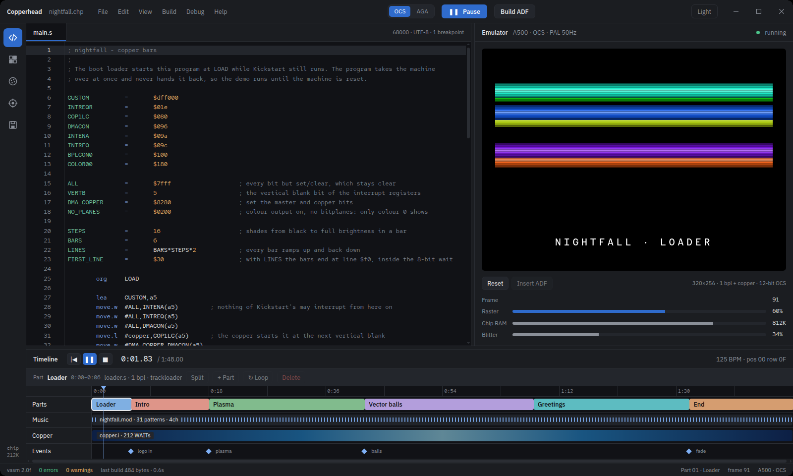

# Copperhead

An Amiga demo and game studio for Linux: write 68000 assembly, paint sprites, shape the palette and the
copper list, step through the debugger, lay parts out on a timeline and build an ADF for an A500 (OCS) or an
A1200 (AGA).



A project is a folder on disk. Its sources are edited in the Code tool, and Build ADF turns them into a bootable
trackloader disk with vasm and Shrinkler, both fetched and compiled for you on first use. The sprite, palette,
debugger, emulator and timeline tools still show sample data, and the disk is not yet run in an emulator.

## Building

You need JDK 25 and Maven.

```bash
mvn install                 # build and test
mvn -pl shell exec:java     # run from the build tree
```

The [wiki](https://github.com/adeptum-labs/copperhead/wiki) has the rest: installing the packages, a tour of the
studio, how a disk is built, the toolchain, the optional build profiles, the architecture and CI.

## Licence

Copyright © 2026 Adam Waldenberg and Adeptum AB. Licensed under the GNU General Public License, version 3; see
`COPYING`.

The editor bundle contains CodeMirror and its companion packages, which are under the MIT licence; their notices
are in `ui/src/main/resources/static/js/editor.bundle.js.provenance`.
